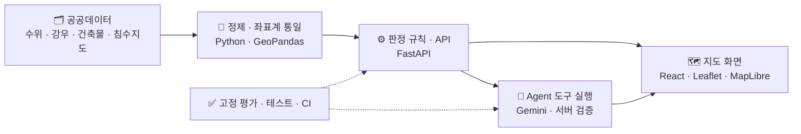
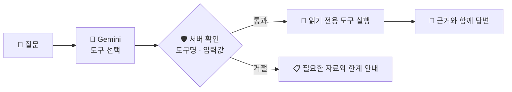

  

  공간정보·수자원 실무 경험을 바탕으로 
  <b>GIS 기반 서비스</b>와 <b>AI Agent</b>를 개발합니다.

  
  
  

---

## 🙋‍♀️ About Me

| | |
|---|---|
| 🎓 **전공** | 건설시스템공학 + 환경공학 |
| 🌊 **실무** | 수자원·공간정보 실무 약 4년 (홍수위험지도·하천 설계 자료) |
| 🗺️ **GIS** | 기관·좌표계가 다른 공공데이터를 건물·시설 단위로 묶는 데이터 처리와 WebGIS |
| 🤖 **AI** | FastAPI 기반 AI 서비스 · LLM이 고르고 서버가 확인하는 Agent 도구 실행 |

---

## 🚀 Featured Projects

### 1. 🏙️ 먼저 가야 할 집

**GIS 기반 주거 정보 서비스** — 서울 지하층 건물의 침수 정보를 한 동 단위로 조회하고, 먼저 확인할 집을 고릅니다.

| 무엇을 했나 | 숫자 |
|---|---|
| 기관·좌표계가 다른 **공공데이터 6종 통합** | 📊 지하층 **377,157동** 등급화 |
| **좌표계·데이터 단위 표준화** 후 건물 한 동 단위로 결합 | 🏠 먼저 확인할 집 **489동** |
| 공간정보와 **건축물대장 연계**, 침수지도가 없는 구는 "위험 없음"으로 두지 않는 대체 규칙 | 🗺️ 대체 규칙 적용 **11개 구** |

  
  
  
  
  
  

[📂 Repository](https://github.com/ssoyoum/Basement-Flood-Vulnerability) | [🌐 Demo](https://basement-flood.duckdns.org) | [🧩 Architecture](https://github.com/ssoyoum/Basement-Flood-Vulnerability/blob/main/docs/assets/system-architecture.svg)

---

### 2. 🌊 만약에 침수

<table>
  <tr>
    <td width="50%" align="center"> 전국 하천 접점 시설 감시</td>
    <td width="50%" align="center"> 도구를 골라 근거로 답하는 Agent</td>
  </tr>
</table>

**AI 기반 침수 대응 서비스** — 수위·강우·특보를 지하차도·하천변 시설의 위험 단계로 바꿔 «어디를 먼저 막을지» 고르게 돕습니다.

- **FastAPI 기반 Agent 도구 구현** — 등록된 읽기 전용 도구만 실행
- **Gemini API 연동** — SDK 없이 직접 호출, 답의 숫자가 도구 결과와 다르면 서버가 바로잡음
- **도구 실행 검증 및 테스트** — 43문항 고정 평가 **43/43**, 근거 없는 주장 **0건**, 토큰 **−21%**
- 600 MB 컨테이너의 메모리 부족 원인을 찾아 **663 → 506 MiB**

  
  
  
  
  

[📂 Repository](https://github.com/ssoyoum/Flood-Disaster-Digital-Twin) | [🌐 Demo](https://floodops.duckdns.org) | [🧩 Architecture](https://github.com/ssoyoum/Flood-Disaster-Digital-Twin/blob/main/docs/ARCHITECTURE.md)

---

### 3. 🛰️ FloodOps / HAND Osong

**수자원·침수 분석 서비스** — 2023 오송 지하차도 등 과거 홍수 사례를 관측 자료로 단계별로 다시 재생하고, 같은 판정 규칙을 실제 통제 시각에 채점합니다. (‘만약에 침수’ 레포의 사례 재생 기능)

- **공간정보 및 수자원 도메인 적용** — 지형(HAND) 기반 침수 범위 근사, 계획홍수위·상승 속도로 통제 검토 시점 계산
- **API 기반 데이터 처리** — 홍수통제소·기상청 관측 자료로 오송·서울·포항·안동 **4개 사례** 재구성
- **서비스 기능 구현** — 궁평2 지하차도 규칙 백테스트에서 유입 **157분 전** 첫 검토, 늦었던 사례도 표에 그대로 남김

> HAND 침수 범위는 임시 근사이며 공식 침수범위나 수리해석 결과가 아닙니다. 백테스트는 실시간 경보 성능이 아닙니다.

[📂 Repository](https://github.com/ssoyoum/Flood-Disaster-Digital-Twin) | [🌐 Demo](https://floodops.duckdns.org) | [🧩 Architecture](https://github.com/ssoyoum/Flood-Disaster-Digital-Twin/blob/main/docs/CASE_REPLAY.md)

---

### ➕ More

| Project | 한 줄 |
|---|---|
| 🔥 [철든신입](https://github.com/steel-rookie/ST-ROOKIE) (팀) | 철강 신입사원 학습 서비스. 담당: JWT 로그인 API, 출처 재확인 학습 튜터, Langfuse trace |
| 🗺️ [의성 유휴자원 정책검토](https://github.com/ssoyoum/Uiseong-Resource-Model) | 전통수리시설 '못' 427개 × 생활권 인구, 현장검토 양식 116개 |
| 💬 [통해](https://github.com/ssoyoum/tonghae) (팀) | 이주노동자 생활 대화 도우미. 앱스토어 리뷰 3,889건 분석으로 기획 · [Demo](https://ssoyoum.github.io/tonghae/) |

---

## 🛠️ Tech Stack

   
   
  
  

| 분야 | 기술 |
|---|---|
| **AI** | LLM · RAG · Gemini API · Agent 도구 실행 · 고정 평가 |
| **Backend** | Python · FastAPI · PostgreSQL · SQLite |
| **Frontend** | React · TypeScript · Leaflet · MapLibre |
| **Spatial** | QGIS · GeoPandas · 좌표계 변환 · HAND |
| **DevOps** | Docker · GitHub Actions · AWS EC2 |

---

  

  

